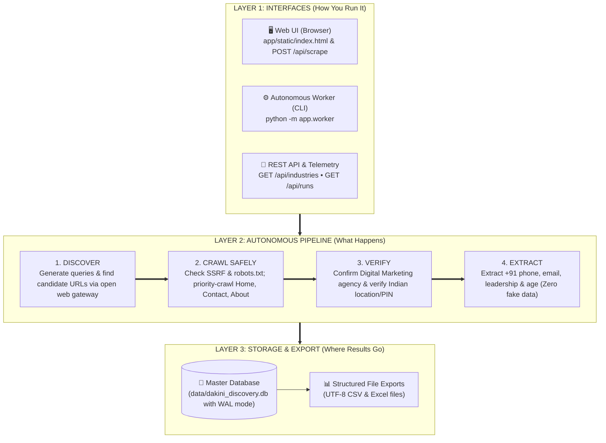

# Dakini AI Autonomous Public-Web Business Discovery System
## System Architecture Specification

---

## 1. High-Level Architectural Diagram (The 3 Layers)



### Simplified 3-Layer ASCII Architecture

```text
=====================================================================================
 LAYER 1: INTERFACES (How You Run It)
=====================================================================================
 [ Web UI (Browser) ]        [ Autonomous Worker (CLI) ]       [ REST API Service ]
 POST /api/scrape            python -m app.worker              GET /api/runs & industries
          │                                │                                │
          └────────────────────────────────┼────────────────────────────────┘
                                           ▼
=====================================================================================
 LAYER 2: AUTONOMOUS PIPELINE (What Happens)
=====================================================================================
  ┌─────────────────┐      ┌─────────────────┐      ┌─────────────────┐      ┌─────────────────┐
  │  1. DISCOVER    │ ───► │ 2. CRAWL SAFELY │ ───► │   3. VERIFY     │ ───► │   4. EXTRACT    │
  │ Generate search │      │ SSRF & robots   │      │ Agency & PIN    │      │ Phone, email &  │
  │ queries & URLs  │      │ priority crawl  │      │ physical checks │      │ leadership proof│
  └─────────────────┘      └─────────────────┘      └─────────────────┘      └─────────────────┘
                                           │
                                           ▼
=====================================================================================
 LAYER 3: STORAGE & EXPORT (Where Results Go)
=====================================================================================
  ┌──────────────────────────────────────────────┐   ┌───────────────────────────────┐
  │ 💾 Master SQLite DB (dakini_discovery.db)     │──►│ 📊 Structured File Exports     │
  │ Companies, evidence excerpts & checkpoints   │   │ UTF-8 CSV with BOM and Excel  │
  └──────────────────────────────────────────────┘   └───────────────────────────────┘
=====================================================================================
```

                                         |
                                         v
+-----------------------------------------------------------------------------------+
|                             PERSISTENT MASTER DATABASE                            |
|                            (data/dakini_discovery.db)                             |
|                                                                                   |
|   +----------------+   +-------------------+   +------------------+               |
|   |   companies    |   | company_evidence  |   | discovered_urls  |               |
|   +----------------+   +-------------------+   +------------------+               |
|   +----------------+   +-------------------+   +------------------+               |
|   | crawl_frontier |   |   domain_policy   |   |  research_runs   |               |
|   +----------------+   +-------------------+   +------------------+               |
|                        +-----------------------+                                  |
|                        | research_checkpoints  |                                  |
|                        +-----------------------+                                  |
+-----------------------------------------------------------------------------------+
```

---

## 2. Architectural Evolution: Old vs. New

| Architectural Dimension | Old POC Architecture | Upgraded Autonomous System |
| :--- | :--- | :--- |
| **Discovery Model** | Seven brittle external sources (Overpass API, Overture Parquet via DuckDB/S3, SearXNG Docker, Wikidata SPARQL, India MCA bulk CSV, AllThePlaces, Common Crawl). | **Generic Public-Web Discovery Gateway** querying open web indexes dynamically; fully independent of fixed third-party directories or local Docker daemons. |
| **Execution Engine** | Ephemeral, synchronous, single-request blocking pipeline in FastAPI. | **Dual Execution**: Synchronous HTTP endpoint (`POST /api/scrape`) AND Autonomous background worker daemon (`python -m app.worker`) with SQLite state polling. |
| **Safety & Security** | Basic in-memory robots check; no SSRF protection. | **Enterprise Crawl Policy**: Pre-DNS resolution SSRF defense (blocks loopback, private subnets, cloud metadata), robots.txt parsing/caching, and zero-bypass halting on 401/403/429/CAPTCHA. |
| **Crawl Frontier** | Single-page scrape (Homepage + Contact page) kept in memory. | **Persistent URL Frontier in SQLite**: Multi-page prioritized queue (Home: 100, Contact: 95, About: 85, Services: 80) with domain budgets and depth limits. |
| **Industry & Location** | Simple string keyword matching against entity names. | **Two-Stage Classifier**: Stage 6A matches 12 marketing subcategories and rejects training courses/academies; Stage 6B verifies physical HQ, Branch, or Service-Area via 6-digit Indian PIN codes and address blocks. |
| **Data Extraction** | Heuristic phone/email extraction. | **Zero Fabrication Fact Extraction**: Strictly extracts verified +91 phones, official emails, leadership, size, and age; records field-level text excerpts and URLs into `company_evidence`. |
| **Lead Qualification** | 100-point ICP scoring formula. | **ICP Scoring Excluded by Discovery Policy**: As mandated, scoring is excluded from the discovery pipeline (`lead_quality_score=0`). |
| **Master Persistence** | Ephemeral CSV writes only; no internal database. | **SQLite WAL Master Store (`data/dakini_discovery.db`)**: 7 relational tables tracking companies, evidence, frontier, domain policies, runs, and checkpoints. |
| **Fault Tolerance** | Unhandled timeouts crashed pipeline; no resume capability. | **Checkpoint Snapshot & Recovery**: Every stage saves atomic checkpoints to SQLite; interrupted runs resume automatically without repeating work. |

---

## 3. Core Subsystems

### 3.1 Industry Category Registry (`app/config.py`)
- Defines a 13-industry configuration matrix.
- **Active Category**: `Digital Marketing` is the sole active category.
  - Subcategories: *Digital Marketing Agencies, SEO Agencies, Search Engine Marketing, Performance Marketing, PPC Management, Social Media Marketing, Content Marketing, Branding and Creative Agencies, Online Advertising, Lead Generation Agencies, Growth Marketing, Marketing Automation*.
- **Configured & Reserved**: *Healthcare, Real Estate, Insurance, Financial Services, Education, Hospitality, E-commerce, Manufacturing, Logistics, Travel, Business Services, SaaS / Technology*.

### 3.2 Intelligent Query Generator (`app/services/query_generator.py`)
- Generates high-intent query permutations across:
  - Core industry and city combinations (e.g. `"digital marketing agency in Mumbai"`).
  - Subcategory expansions (e.g. `"SEO company in Mumbai"`, `"performance marketing agency in Mumbai"`).
  - Locality-level drill-downs (e.g. `"digital marketing agency in Andheri"`, `"digital marketing agency in Bandra"`).

### 3.3 Generic Public-Web Discovery Gateway (`app/services/public_web_discovery.py`)
- Replaces legacy providers with dynamic web discovery.
- Queries open web search interfaces and encyclopedic link indexes.
- Filters out non-company aggregators, social networks, and review directories (Justdial, Sulekha, Indiamart, Facebook, LinkedIn, Glassdoor, etc.).

### 3.4 Crawl Policy, Safety & Compliance Engine (`app/services/crawl_policy.py`)
- **SSRF Defense**: Resolves domain IPs via `socket.getaddrinfo` before connection; blocks loopback (`127.0.0.0/8`, `::1`), private subnets (`10.0.0.0/8`, `172.16.0.0/12`, `192.168.0.0/16`), link-local (`169.254.0.0/16`), and cloud metadata (`169.254.169.254`).
- **Robots.txt**: Parses, caches, and enforces per-domain directives and crawl delays.
- **Anti-Bot & Authentication**: Halts immediately on HTTP 401, 403, 429, or CAPTCHA challenge signatures (Cloudflare Turnstile, reCAPTCHA, etc.) without attempting bypass.
- **Politeness**: Enforces per-domain request delay pacing and transparent User-Agent identification.

### 3.5 Persistent URL Frontier & Autonomous Crawler (`app/services/url_frontier.py` & `app/services/crawler.py`)
- Prioritizes high-intent pages: `Homepage (100) > Contact / Branches (95) > About (85) > Services (80) > Other (50)`.
- Enforces crawl depth limits (`CRAWLER_MAX_DEPTH = 2`) and per-domain page budgets (`CRAWLER_MAX_PAGES_PER_DOMAIN = 5`).
- Concurrently crawls approved URLs via a worker thread pool.

### 3.6 Classification & Verification Pipeline (`app/services/industry_classifier.py` & `app/services/location_verifier.py`)
- **Stage 6A (Industry)**: Classifies genuine agency websites, determines subcategory, and excludes training academies, student courses, and job portals.
- **Stage 6B (Location)**: Verifies geographic presence by analyzing address blocks and Indian postal PIN codes:
  - `headquarters`: Explicit HQ / registered office with address in target city.
  - `branch`: Documented branch office in target city.
  - `service_area`: Services offered for target city without physical facility.

### 3.7 Data Extraction & Validation (`app/services/extraction.py` & `app/services/validation.py`)
- Extracts published facts: company name, normalized Indian phone (`+91XXXXXXXXXX`), official email, leadership names/roles, company size, founding age, and service lists.
- **Zero Fabrication**: Missing data is stored as `unknown` or `""`; unverified values are never generated.
- Field-level evidence items capture exact text excerpts and source URLs.
- **Scoring Exclusion**: Sets `lead_quality_score=0`; Dakini AI ICP scoring is excluded from the active discovery workflow.

### 3.8 Internal Master Database (`app/services/persistence.py`)
Built on Python's standard library `sqlite3` with Write-Ahead Logging (WAL) and foreign keys enabled:
1. `companies`: Canonical business profiles, locations, contacts, and verification tiers.
2. `company_evidence`: Field-level evidence snippets, timestamps, and source URLs.
3. `discovered_urls`: All candidate URLs discovered with provenance query.
4. `crawl_frontier`: Queue of pending, crawling, completed, and blocked crawl tasks.
5. `domain_policy`: Domain-level robots decisions, crawl delays, and block reasons.
6. `research_runs`: Run execution metrics, counts, and completion statuses.
7. `research_checkpoints`: Stage checkpoints for interrupted run recovery.

### 3.9 Autonomous Execution Engine (`app/worker.py`)
- Independent Python CLI process (`python -m app.worker`).
- Single-worker locking via `data/worker.lock` to avoid duplicate concurrent executions.
- Polls SQLite for queued or interrupted runs.
- Graceful shutdown handling on SIGINT/SIGTERM.
- Checkpoint recovery: Resumes unfinished runs from the exact interrupted stage.

---

## 4. Master Database Schema (`data/dakini_discovery.db`)

```text
+------------------------------------------------------------------------------------+
|                                    companies                                       |
+------------------------------------------------------------------------------------+
| company_id (TEXT PK)       | canonical_name (TEXT)     | domain (TEXT UNIQUE)      |
| brand_name (TEXT)          | cin (TEXT)                | industry_category (TEXT)  |
| subcategory (TEXT)         | country (TEXT)            | state (TEXT)              |
| city (TEXT)                | locality (TEXT)           | postal_code (TEXT)        |
| full_address (TEXT)        | location_type (TEXT)      | phone (TEXT)              |
| email (TEXT)               | website (TEXT)            | company_size (TEXT)       |
| company_age (TEXT)         | leadership (TEXT JSON)    | services (TEXT JSON)      |
| verification_status (TEXT) | created_at (INTEGER)      | updated_at (INTEGER)      |
+------------------------------------------------------------------------------------+
                                      |
                                      | 1 : N
                                      v
+------------------------------------------------------------------------------------+
|                                company_evidence                                    |
+------------------------------------------------------------------------------------+
| evidence_id (TEXT PK)      | company_id (TEXT FK)      | field_name (TEXT)         |
| observed_value (TEXT)      | source_url (TEXT)         | source_page_title (TEXT)  |
| evidence_snippet (TEXT)    | confidence_score (REAL)   | extracted_at (INTEGER)    |
+------------------------------------------------------------------------------------+

+------------------------------------------------------------------------------------+
|                                 discovered_urls                                    |
+------------------------------------------------------------------------------------+
| url_id (TEXT PK)           | url (TEXT UNIQUE)         | domain (TEXT)             |
| discovery_query (TEXT)     | discovery_source (TEXT)   | run_id (TEXT)             |
| discovered_at (INTEGER)    | status (TEXT)             |                           |
+------------------------------------------------------------------------------------+

+------------------------------------------------------------------------------------+
|                                 crawl_frontier                                     |
+------------------------------------------------------------------------------------+
| frontier_id (TEXT PK)      | url (TEXT UNIQUE)         | domain (TEXT)             |
| page_type (TEXT)           | depth (INTEGER)           | priority (INTEGER)        |
| status (TEXT)              | retry_count (INTEGER)     | last_error (TEXT)         |
| queued_at (INTEGER)        | completed_at (INTEGER)    |                           |
+------------------------------------------------------------------------------------+

+------------------------------------------------------------------------------------+
|                                 domain_policy                                      |
+------------------------------------------------------------------------------------+
| domain (TEXT PK)           | robots_allowed (INTEGER)  | crawl_delay (REAL)        |
| user_agent (TEXT)          | blocked_reason (TEXT)     | last_checked_at (INTEGER) |
+------------------------------------------------------------------------------------+

+------------------------------------------------------------------------------------+
|                                 research_runs                                      |
+------------------------------------------------------------------------------------+
| run_id (TEXT PK)           | industry (TEXT)           | city (TEXT)               |
| state (TEXT)               | country (TEXT)            | locality (TEXT)           |
| execution_status (TEXT)    | total_discovered (INTEGER)| total_crawled (INTEGER)   |
| total_verified (INTEGER)   | started_at (INTEGER)      | completed_at (INTEGER)    |
| trigger_type (TEXT)        | error_log (TEXT)          |                           |
+------------------------------------------------------------------------------------+

+------------------------------------------------------------------------------------+
|                              research_checkpoints                                  |
+------------------------------------------------------------------------------------+
| checkpoint_id (TEXT PK)    | run_id (TEXT FK)          | stage_name (TEXT)         |
| stage_index (INTEGER)      | state_payload (TEXT JSON) | created_at (INTEGER)      |
+------------------------------------------------------------------------------------+
```

---

## 5. End-to-End Execution Sequence

```mermaid
sequenceDiagram
    autonumber
    actor User as User / Worker
    participant API as FastAPI / Worker Engine
    participant S1 as Stage 1-2: Query Generator
    participant S3 as Stage 3: Public Web Discovery
    participant S4 as Stage 4: Crawl Policy Filter
    participant S5 as Stage 5: URL Frontier & Crawler
    participant S6 as Stage 6: Classifiers (Industry/Location)
    participant S7 as Stage 7-8: Extraction & Validation
    participant DB as SQLite WAL Master DB
    participant Exp as Stage 10: Exporter

    User->>API: Execute Research Run (City, Category, Limit)
    API->>DB: create_research_run(run_id, status='running')
    API->>S1: Generate Discovery Queries (Core, Subcategory, Locality)
    S1-->>API: List of queries
    API->>DB: save_checkpoint("stage_2_queries_generated")

    API->>S3: Discover candidate URLs via Open Web Gateway
    S3-->>API: Normalized company root URLs
    API->>DB: Insert into discovered_urls

    loop For each candidate domain
        API->>S4: Evaluate domain safety (SSRF, robots.txt, IP range)
        alt Safe & Allowed
            S4-->>API: Domain policy OK
            API->>S5: Enqueue domain pages into crawl_frontier
        else Disallowed / Private / CAPTCHA
            S4-->>API: Mark blocked
            API->>DB: Record blocked_reason in domain_policy
        end
    end

    API->>S5: Execute multi-page crawl (Home, Contact, About, Services)
    S5-->>API: Fetched HTML pages with status 200

    loop For each crawled company
        API->>S6: Classify Industry (Digital Marketing subcategory; reject courses)
        API->>S6: Verify Location (HQ, Branch, Service-Area + PIN)
        API->>S7: Extract facts (+91 phone, email, leadership, age, size)
        API->>S7: Validate format & link ownership (Lead score = 0)
        API->>DB: Upsert company into companies
        API->>DB: Append field-level evidence into company_evidence
    end

    API->>DB: save_checkpoint("stage_9_persisted")
    API->>Exp: Generate UTF-8 CSV with BOM (data/<city>_<category>_leads.csv)
    API->>DB: update_research_run(status='completed')
    API-->>User: ScrapeResponse / Export ready
```

---

## 6. API & UI Compatibility Contract

The existing frontend ([`app/static/index.html`](file:///d:/geographical_scraping_system/app/static/index.html)) and endpoints remain strictly preserved:
- `GET /` — Serves existing static web UI.
- `GET /health` & `GET /api/health` — Service health probe.
- `POST /api/scrape` — Synchronous discovery endpoint returning `ScrapeResponse` JSON.
- `GET /api/download?path=...` — Downloads generated CSV export.
- `GET /architecture` — Interactive architecture diagram viewer with one-click SVG/PNG downloads.
- `GET /architecture.svg` or `GET /api/architecture/diagram` — Direct vector SVG diagram download.
- `GET /api/industries` — Catalog of 13 industries showing `Digital Marketing` as active.
- `GET /api/runs` — History of autonomous research runs.
- `POST /api/runs` — Queue an asynchronous research run for background worker execution.
- `GET /api/runs/{run_id}` — Run metrics and latest checkpoint details.
- `POST /api/runs/{run_id}/resume` — Resumes an interrupted run.
