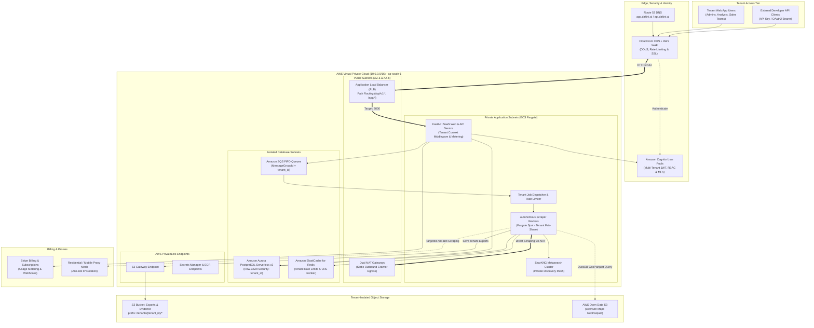
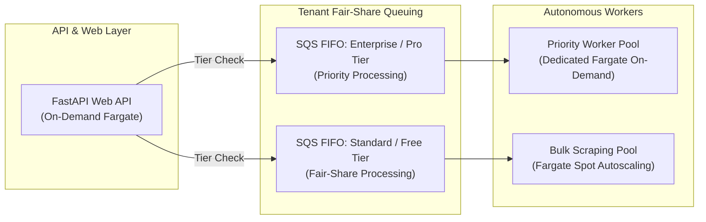
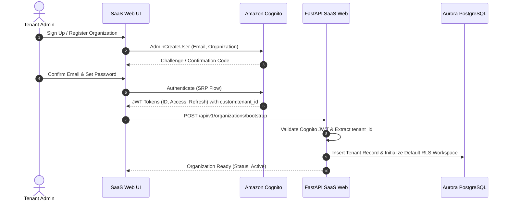
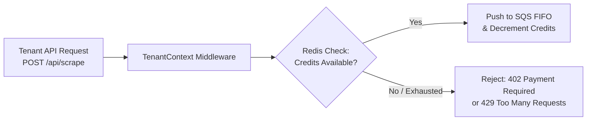
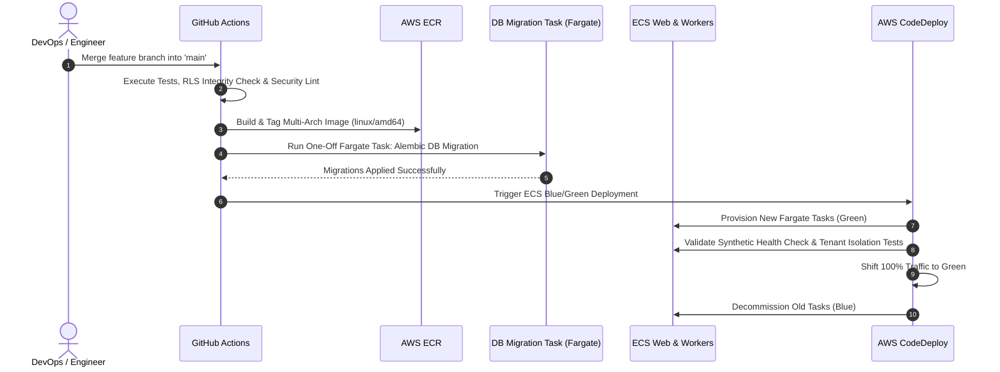
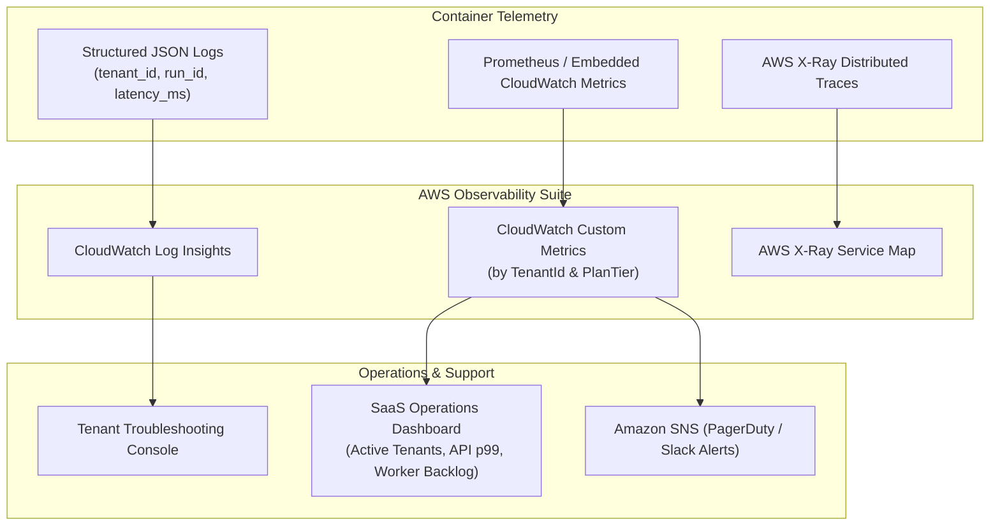

# Multi-Tenant B2B SaaS Cloud Deployment Plan (AWS)
## Geographical Lead Scraping & Autonomous Intelligence Platform

---

## 1. High-Level Multi-Tenant SaaS Architecture

The platform operates on a **pooled multi-tenant SaaS model** designed for high throughput, tenant data isolation, and fair-share background scraping job execution.



---

## 2. Network Topology & VPC Segmentation for SaaS

The network topology strictly segregates client-facing web services, compute workers, and sensitive multi-tenant database clusters.

| Subnet Tier | CIDR Block (AZ-a) | CIDR Block (AZ-b) | Inbound Access | Outbound Egress |
| :--- | :--- | :--- | :--- | :--- |
| **Public Subnets** | `10.0.1.0/24` | `10.0.2.0/24` | HTTPS (443) from CloudFront | Internet Gateway (`igw-xxxx`) |
| **Private Compute** | `10.0.10.0/23` | `10.0.12.0/23` | From ALB Target Groups only | Through NAT Gateways / VPC Endpoints |
| **Isolated Data** | `10.0.20.0/24` | `10.0.21.0/24` | Port 5432 (Aurora) & 6379 (Redis) from App Subnets | None (No Internet Gateway / No NAT) |

### SaaS Outbound Crawling & IP Reputation Strategy
1. **Dedicated NAT Gateway Pool**:
   - Outbound requests to verified open government datasets and OSM Overpass mirrors egress through two dedicated AWS Elastic IPs (EIPs).
2. **Rotating Commercial Proxy Gateway**:
   - Commercial target crawls (lead websites, local agencies) are routed through upstream rotating residential/ISP proxy meshes to circumvent aggressive bot-detection and cloud IP throttling.
3. **SSRF Mitigation & Tenant Blast-Radius Containment**:
   - Enforce AWS IMDSv2 (`http-tokens=required`, `http-put-response-hop-limit=1`).
   - Egress firewall rules disallow internal VPC addresses (`10.0.0.0/16`) and local loopback/link-local CIDRs from crawler containers.

---

## 3. Compute & Container Orchestration (Multi-Tenant ECS Fargate)

### Multi-Tenant Workload Decoupling
To prevent one tenant from degrading platform performance for others, compute is decoupled into specialized ECS services:



1. **`saas-web-api` (FastAPI + Uvicorn)**:
   - Sizing: `0.5 vCPU`, `1.0 GB RAM` per task (Autoscales: 2 to 10 tasks).
   - Injects `TenantContext(tenant_id, plan_tier, credits_remaining)` into every FastAPI request scope via JWT / API key claims.
2. **`saas-scraper-worker` (Background Discovery Engine)**:
   - Sizing: `1.0 vCPU`, `2.0 GB RAM` (Autoscales via SQS queue depth).
   - Utilizes **Fargate Spot** to optimize background scraping compute.
   - Executes crawling, verification, and lead scoring scoped strictly to the initiating `tenant_id`.
3. **`saas-searxng` (Internal Discovery Mesh)**:
   - Sizing: `0.5 vCPU`, `1.0 GB RAM`.
   - Internal service with AWS Cloud Map Service Connect (`http://searxng.internal:8080`).

---

## 4. Multi-Tenant Data Architecture & Storage Isolation

### 1. Amazon Aurora PostgreSQL with Row-Level Security (RLS)
The database uses a **shared database, shared schema** architecture with PostgreSQL Row-Level Security (RLS) to enforce absolute logical isolation between tenants.

#### Tenant Isolation Schema Pattern:
Every table in `supabase_schema.sql` is augmented with a mandatory `tenant_id` foreign key:

```sql
-- Enable Row Level Security on core business leads
ALTER TABLE public.companies ENABLE ROW LEVEL SECURITY;
ALTER TABLE public.company_evidence ENABLE ROW LEVEL SECURITY;
ALTER TABLE public.discovered_urls ENABLE ROW LEVEL SECURITY;
ALTER TABLE public.research_runs ENABLE ROW LEVEL SECURITY;

-- Tenant Isolation Policy
CREATE POLICY tenant_isolation_companies ON public.companies
    FOR ALL
    USING (tenant_id = current_setting('app.current_tenant_id', true)::uuid);

CREATE POLICY tenant_isolation_evidence ON public.company_evidence
    FOR ALL
    USING (tenant_id = current_setting('app.current_tenant_id', true)::uuid);

-- Automated Session Variable Setter in FastAPI Connection Pool
-- Before query execution: SET LOCAL app.current_tenant_id = '<tenant_uuid>';
```

### 2. Tenant-Isolated Amazon S3 Bucket Architecture
Storage for exports (CSV, XLSX) and raw HTML evidence snippets is segmented by tenant prefix:

```text
s3://dakini-saas-production-exports/
├── tenants/
│   ├── tenant_a29e4b10/
│   │   ├── exports/
│   │   │   └── run_20261112_mumbai_marketing.xlsx
│   │   └── evidence/
│   │       └── domain_audit_excerpts.json.gz
│   └── tenant_f81b2c44/
│       └── exports/
│           └── run_20261112_delhi_leads.csv
```

- **IAM Tenant Scoping**: IAM policies use condition keys (`s3:prefix = ["tenants/${aws:PrincipalTag/TenantId}/*"]`) to mathematically prevent cross-tenant data access.
- **S3 Presigned URLs**: Client download links for exports are dynamically generated with an expiration window of 15 minutes.

### 3. Redis Multi-Tenant Partitioning
ElastiCache Redis keys are prefixed with the tenant namespace:
- Rate Limiting: `ratelimit:{tenant_id}:{minute_timestamp}`
- URL Deduplication: `frontier:{tenant_id}:seen_hashes`
- Worker Locks: `lock:{tenant_id}:active_run`

---

## 5. Tenant Onboarding, Authentication & RBAC



### Authentication & Role Matrix
- **Amazon Cognito User Pool**:
  - Custom attributes: `custom:tenant_id` (UUID), `custom:subscription_tier` (`free`, `pro`, `enterprise`).
  - Cognito Groups for RBAC: `TenantAdmin`, `TenantMember`, `TenantReadOnly`.
- **API Key Management for Programmatic Ingestion**:
  - Tenants can generate hashed API keys (`dk_live_...`) with fine-grained scopes (`leads:read`, `scrape:write`).
  - Stored in Aurora with SHA-256 hashing and checked against ElastiCache Redis for fast authentication caching.

---

## 6. SaaS API Tier, Metering & Billing Integration

### 1. Subscription & Credit Consumption Flow


### 2. Stripe Webhook & Credit Synchronization
- Webhooks (`customer.subscription.created`, `invoice.paid`, `customer.subscription.deleted`) update tenant plan status and reset monthly lead generation quotas in Aurora.
- Usage-based metered billing is reported back to Stripe via the Stripe Usage Records API based on verified leads returned.

---

## 7. Containerization & Production Dockerfile

### Multi-Stage SaaS Container Build (`Dockerfile`)
```dockerfile
# Multi-stage production build for SaaS Web & Worker services
FROM python:3.11-slim-bullseye AS build-stage

WORKDIR /build
RUN apt-get update && apt-get install -y --no-install-recommends \
    build-essential \
    curl \
    && rm -rf /var/lib/apt/lists/*

COPY requirements.txt .
RUN pip install --no-cache-dir --prefix=/install -r requirements.txt

# Final Minimal Distroless/Slim Runtime
FROM python:3.11-slim-bullseye

WORKDIR /app

RUN apt-get update && apt-get install -y --no-install-recommends \
    ca-certificates \
    curl \
    && rm -rf /var/lib/apt/lists/*

# Create unprivileged SaaS service user
RUN groupadd -g 2001 saasuser && \
    useradd -u 2001 -g saasuser -s /bin/bash -m saasuser

COPY --from=build-stage /install /usr/local
COPY . /app

RUN mkdir -p /app/data /app/exports && \
    chown -R saasuser:saasuser /app

USER saasuser

ENV PYTHONUNBUFFERED=1 \
    PYTHONDONTWRITEBYTECODE=1 \
    PYTHONPATH=/app

EXPOSE 8000

HEALTHCHECK --interval=20s --timeout=4s --start-period=10s --retries=3 \
    CMD curl -f http://127.0.0.1:8000/api/health || exit 1

ENTRYPOINT ["uvicorn", "app.main:app", "--host", "0.0.0.0", "--port", "8000", "--workers", "4"]
```

---

## 8. Infrastructure as Code (Terraform SaaS Blueprints)

### Multi-Tenant Modular Structure
```text
terraform/
├── modules/
│   ├── cognito/         # User Pool, App Clients, Custom Attributes, User Groups
│   ├── vpc/             # Multi-AZ VPC, Public & Private Subnets, NAT Gateways
│   ├── aurora_saas/     # Aurora PostgreSQL Serverless v2 with RLS extensions
│   ├── ecs_saas/        # Web API & Worker Services, Task Definitions, Autoscaling
│   ├── sqs_queues/      # FIFO Queues for tenant-fair-share message scheduling
│   ├── redis/           # ElastiCache Redis for tenant caching & rate limits
│   └── s3_storage/      # Tenant-partitioned exports bucket & IAM policies
├── environments/
│   ├── staging/
│   └── production/
```

### Multi-Tenant SQS FIFO Queue (`modules/sqs_queues/main.tf`)
```hcl
resource "aws_sqs_queue" "tenant_scraping_jobs" {
  name                        = "dakini-tenant-scraping-jobs.fifo"
  fifo_queue                  = true
  content_based_deduplication = true
  visibility_timeout_seconds  = 900
  message_retention_seconds   = 86400

  # Dead Letter Queue for failed crawls
  redrive_policy = jsonencode({
    deadLetterTargetArn = aws_sqs_queue.scraping_dlq.arn
    maxReceiveCount     = 3
  })
}

resource "aws_sqs_queue" "scraping_dlq" {
  name       = "dakini-tenant-scraping-dlq.fifo"
  fifo_queue = true
}
```

---

## 9. Continuous Integration & Deployment (CI/CD)

The SaaS CI/CD pipeline ensures zero-downtime rolling deployments and automated tenant migration execution.



---

## 10. SaaS Security, Governance & Isolation Verification

1. **Defense-in-Depth Tenant Isolation**:
   - Every database session executes `SET LOCAL app.current_tenant_id = :tenant_id` within the transactional block.
   - Integration tests continuously verify that synthetic Tenant A cannot read, query, or modify records belonging to Tenant B.
2. **KMS Multi-Tenant Encryption**:
   - Aurora database volumes, S3 buckets, and SQS messages are encrypted with an AWS KMS customer managed key (CMK).
3. **AWS WAF Protection**:
   - Rate limiting per client IP (protects API endpoints from scraping abuse).
   - SQLi, XSS, and Common Vulnerabilities rule groups applied at CloudFront.
4. **Tenant Data Offboarding (GDPR / Indian DPDP Compliance)**:
   - Automated cascade deletion script that strips tenant records from `companies`, `company_evidence`, `research_runs`, and purges S3 prefix `s3://bucket/tenants/{tenant_id}/` upon organization termination.

---

## 11. Monitoring, Observability & Tenant-Aware Telemetry



### Critical SaaS Operational Metrics
- **Tenant Fair-Share Starvation Index**: Tracks maximum wait time for messages in SQS across tenant tiers.
- **Credit Burn Rate**: Monitors real-time lead qualification credits consumed per hour per tenant.
- **Anti-Bot Blocking Metric**: Flags proxy failure rates exceeding 10% on external crawling tasks.

