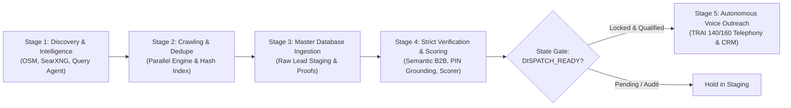

# Dakini AI: Autonomous Geographical Lead Scraping & Intelligence System

[](https://www.python.org/downloads/)
[](https://fastapi.tiangolo.com)
[](https://sqlite.org/wal.html)
[](https://trai.gov.in)
[](#)

An enterprise-grade autonomous intelligence system engineered to discover, crawl, verify, qualify, and score B2B companies across India (starting with Digital Marketing Agencies). Powered by a deterministic multi-source public web gateway, asynchronous SSRF-safe crawling, contextual address grounding, 100-point ICP scoring, and an auto-initializing master persistence database.

---


## 1. System Architecture: The 5-Stage Core Pipeline

The system strictly executes across a deterministic 5-stage sequential architecture:



### Simplified Data Flow
```text
┌─────────────────────────┐     ┌─────────────────────────┐     ┌─────────────────────────┐
│  1. RAW PUBLIC WEB      │     │  2. AUTONOMOUS CRAWLER  │     │  3. MASTER DATABASE     │
│  • OSM Overpass Gateway │ ──> │  • Async Concurrency    │ ──> │  • SQLite WAL / Postgres│
│  • SearXNG Metasearch   │     │  • SSRF & robots.txt    │     │  • Discovered Frontier  │
│  • Dynamic Query Agent  │     │  • Tri-Level CIN Dedupe │     │  • Raw Evidence Proofs  │
└─────────────────────────┘     └─────────────────────────┘     └───────────┬─────────────┘
                                                                            │
┌─────────────────────────┐     ┌─────────────────────────┐                 │
│  5. AUTONOMOUS OUTREACH │     │  4. STRICT VERIFICATION │                 │
│  • TRAI DLT 140/160 CLI │ <── │  • Semantic B2B Filter  │ <───────────────┘
│  • Silero AMD (<1.2s)   │     │  • Contextual PIN Check │
│  • Full-Duplex Voice SDR│     │  • 100-Pt ICP Scorer    │
└─────────────────────────┘     └─────────────────────────┘
```

---

## 2. Core Capabilities

- **Zero Fake Data Guarantee**: Extracts exclusively factual public data verified directly from crawled web pages and corporate registries. Every extracted phone number and address is pinned to raw excerpt citations in `company_evidence`.
- **Public-Web Discovery Gateway**: Queries OpenStreetMap (OSM) Overpass API, private SearXNG Docker metasearch, Overture Maps S3 GeoParquet, and MCA registries to discover target agencies without commercial API dependencies.
- **Async Priority Crawling**: High-speed, politeness-governed crawler (`app/services/crawler.py`) that prioritizes homepage, `/contact`, and `/about` pages while enforcing strict private-network SSRF protection and robots.txt caching.
- **Strict Indian Geographic Grounding**: Disambiguates corporate headquarters from client case studies (`location_verifier.py`). Validates Indian 6-digit Postal Index Numbers (PIN codes) and local phone numbers (`+91` landlines & mobiles).
- **Semantic B2B Agency Verification**: Distinguishes genuine B2B service agencies from educational coaching institutes, colleges, job boards, and affiliate directories.
- **Self-Initializing Master Database**: Zero manual setup required. `persistence.py` automatically initializes SQLite in Write-Ahead Logging (WAL) mode, creating all tables, indexes, and directory structures on first launch.
- **Production Exporters**: One-click generation of beautifully formatted Excel (`.xlsx`) workbooks and UTF-8 CSV exports with full evidence audit logs.

---

## 3. Technology Stack

- **Backend Framework**: Python 3.10+, FastAPI, Uvicorn (ASGI)
- **Crawler & HTTP**: Async HTTPX, BeautifulSoup4, urllib3, robots.txt parser
- **Database & Storage**: SQLite 3 (WAL Mode), DuckDB (Remote GeoParquet query engine), PostgreSQL / Supabase
- **Frontend Dashboard**: Native HTML5, CSS3, ES6 JavaScript (Zero external node_modules build step)
- **Discovery Gateway**: Docker-based SearXNG instance + OpenStreetMap Overpass
- **Testing & Quality Assurance**: Python `unittest` suite (58 automated unit and integration tests)

---

## 4. Quick Start Guide

### Step 1: Clone the Repository
```bash
git clone https://github.com/swastik-mishra25/geographical_scraping_system.git
cd geographical_scraping_system
```

### Step 2: Create and Activate Virtual Environment

**On Windows (PowerShell):**
```powershell
python -m venv .venv
.\.venv\Scripts\activate
pip install -r requirements.txt
```

**On Linux / macOS:**
```bash
python3 -m venv .venv
source .venv/bin/activate
pip install -r requirements.txt
```

### Step 3: Configure Environment Variables
Create your local `.env` configuration from the provided template:

**Windows:**
```powershell
Copy-Item .env.example .env
```

**Linux / macOS:**
```bash
cp .env.example .env
```

### Step 4: Run the Application Server
Launch the application using the master runner:
```bash
python run.py
```
*Or directly via Uvicorn:*
```bash
uvicorn app.main:app --host 127.0.0.1 --port 8000 --reload
```

Open your browser and navigate to:
👉 **`http://127.0.0.1:8000`** to access the live web dashboard.

---

## 5. Autonomous Background Execution

For autonomous, long-running research jobs without keeping the browser open:

```powershell
# Run the autonomous worker across Indian target cities
python -m app.worker --industry "Digital Marketing" --locations "Mumbai,Bengaluru,Pune,Delhi"
```

The autonomous worker will:
1. Dynamically synthesize search queries and query the public web gateway.
2. Ingest and deduplicate candidate domains into the Master Database (Stage 3).
3. Crawl, extract, and strictly score leads (Stage 4).
4. Export high-scoring leads (`score >= 50`) into `data/exports/`.

---

## 6. CRM & Customer Webhook Integration (REST API)

The system includes an enterprise CRM synchronization and webhook export engine (`app/services/crm_service.py`), with pre-built adapters for **HubSpot**, **Zoho CRM**, **Generic REST**, and **Universal Webhooks**. Discovered leads can be synced on demand or automatically forwarded in real-time upon scrape completion based on city filter subscriptions.

### Supported CRM Adapters & Schemas

| Adapter | Payload Contract | Authentication Header |
| :--- | :--- | :--- |
| **Universal Webhook** | Structured JSON with event, city, and lead records | Bearer / Custom Header |
| **HubSpot** | Batch Companies API (`inputs: [{ properties }]`) | `Authorization: Bearer <API_KEY>` |
| **Zoho CRM** | Batch Leads API (`data: [{ Company, Phone, City, ... }]`) | `Authorization: Zoho-oauthtoken <TOKEN>` |
| **Generic REST** | Direct JSON array / object with custom field mapping | Configurable Custom Headers |

### REST API Endpoints

```text
POST   /api/crm/destinations       # Register a customer CRM endpoint
GET    /api/crm/destinations       # List registered destinations (filter by ?city=)
GET    /api/crm/destinations/{id}  # Get destination details
PUT    /api/crm/destinations/{id}  # Update destination configuration / credentials
DELETE /api/crm/destinations/{id}  # Delete destination
POST   /api/crm/export             # Export leads to destination, dynamic URL, or broadcast
POST   /api/crm/test               # Test connection / ping an endpoint
GET    /api/crm/logs               # Retrieve audit trail of CRM dispatches
```

### Automated Scrape Sync (`auto_sync=True`)
When registered destinations specify a city filter (e.g. `Delhi, Mumbai` or `*` for all metros) and have `auto_sync=True`, the autonomous pipeline immediately and asynchronously forwards all verified leads to their endpoints as soon as scraping completes.

---

## 7. Running Automated Tests

Run the complete test suite verifying API contracts, autonomous pipeline logic, phone validation, and backend components:

**Windows (PowerShell):**
```powershell
$env:PYTHONPATH="."
.\.venv\Scripts\python -m unittest discover -s tests -p "test_*.py" -v
```

**Linux / macOS:**
```bash
PYTHONPATH="." python -m unittest discover -s tests -p "test_*.py" -v
```

---

## 8. Historical Development Archives

This repository maintains legacy codebase milestones in dedicated, non-intrusive archive folders (ignored by Git to keep production clones lightweight):

| Archive Folder | Milestone Description |
| :--- | :--- |
| 📁 `archive_initial_cli_poc/` | Original baseline Command-Line Interface (CLI) proof-of-concept scraper. |
| 📁 `archive_web_ui_dashboard/` | Milestone introducing FastAPI REST endpoints and the browser Web UI. |
| 📁 `archive_speed_optimized/` | Crawler performance milestone introducing async concurrency and in-memory robots caching. |
| 📁 `archive_autonomous_pipeline/` | Autonomous pipeline milestone introducing background worker execution and persistent frontiers. |

---

## 9. Compliance and Legal Safeguards

- **Polite Public Crawling**: Identifies transparently via customized `USER_AGENT`, respects `robots.txt` disallow rules, and enforces polite per-domain request throttles (`REQUEST_DELAY_SECONDS=1.0`).
- **SSRF Hardening**: Protects against Server-Side Request Forgery by actively blocking DNS resolution to loopback (`127.0.0.1`), private RFC 1918 subnets (`10.0.0.0/8`, `192.168.0.0/16`, `172.16.0.0/12`), link-local IPs, and cloud metadata endpoints (`169.254.169.254`).
- **TRAI & Telecom Compliance**: Built for integration with TRAI TCCCPR 2018 regulations, requiring outbound commercial calling to operate strictly over enterprise DLT-registered 140/160 series numbers during legal business hours (10:00 AM – 6:00 PM IST).
- **DPDP Act 2023 Readiness**: Restricts data collection strictly to publicly published corporate B2B coordinates and supports automated suppression list management.

---

## 10. Project Directory Structure

```text
geographical_scraping_system/
├── app/
│   ├── main.py                   # FastAPI REST API application & static file mount
│   ├── config.py                 # Central configuration, timeouts, weights & paths
│   ├── models.py                 # Pydantic data schemas & contracts (including CRM schemas)
│   ├── worker.py                 # Autonomous CLI background worker
│   ├── services/
│   │   ├── crawler.py            # Async HTTP priority web crawler (SSRF safe)
│   │   ├── crawl_policy.py       # robots.txt caching & polite delays
│   │   ├── crm_service.py        # HubSpot, Zoho, Webhook & REST CRM export engine
│   │   ├── dedupe.py             # Tri-level entity deduplicator (CIN, Domain, Hash)
│   │   ├── discovery.py          # Multi-source discovery orchestrator
│   │   ├── discovery_catalog.py  # Search query catalogs & industry configurations
│   │   ├── enrichment.py         # Metadata & social channel enrichment
│   │   ├── exporter.py           # Excel (.xlsx) & CSV export generator
│   │   ├── extraction.py         # +91 phone, email, and address parser
│   │   ├── industry_classifier.py# Digital Marketing & B2B agency verifier
│   │   ├── location_verifier.py  # Contextual Indian PIN code & city grounding
│   │   ├── orchestrator.py       # Pipeline execution coordinator with CRM auto-sync
│   │   ├── persistence.py        # Self-initializing SQLite master database layer & CRM storage
│   │   ├── pipeline.py           # Core discovery-to-qualification pipeline
│   │   ├── public_web_discovery.py# Public gateway (OSM, SearXNG, MCA, Overture)
│   │   ├── query_generator.py    # Active learning search query synthesizer
│   │   ├── robots.py             # robots.txt fetcher & compliance validator
│   │   ├── scoring.py            # Dakini 100-Point ICP qualification scorer
│   │   ├── supabase_client.py    # PostgreSQL / Supabase cloud synchronizer
│   │   ├── url_frontier.py       # Persistent BFS URL queue manager
│   │   └── validation.py         # Phone (+91), email, and domain validation
│   └── static/                   # Production Web UI dashboard (HTML, CSS, JS with CRM hub)
├── searxng/                      # Docker Compose & config for private search gateway
├── scripts/                      # Utility scripts (Supabase migration, diagram generators)
├── tests/                        # Automated unit and integration test suite (73 tests)
│   ├── test_api.py               # REST API endpoint tests
│   ├── test_autonomous_system.py # End-to-end autonomous discovery tests
│   ├── test_autonomous_worker.py # Background worker tests
│   ├── test_backend.py           # Services, scoring, and persistence tests
│   ├── test_crm_service.py       # CRM adapters, CRUD, dynamic export & audit tests
│   └── test_phone_extraction.py  # Indian phone regex & normalization tests
├── .env.example                  # Environment configuration template
├── .gitignore                    # Clean Git ignore rules (data, docs, archives)
├── requirements.txt              # Production Python package dependencies
├── run.py                        # Master system launcher script
└── README.md                     # System documentation
```
